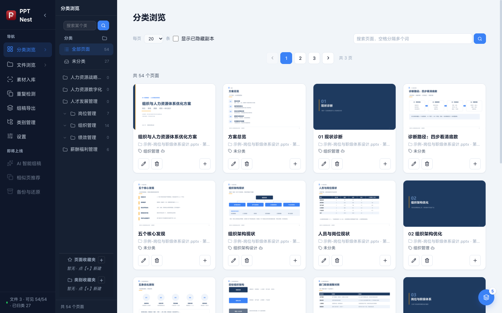
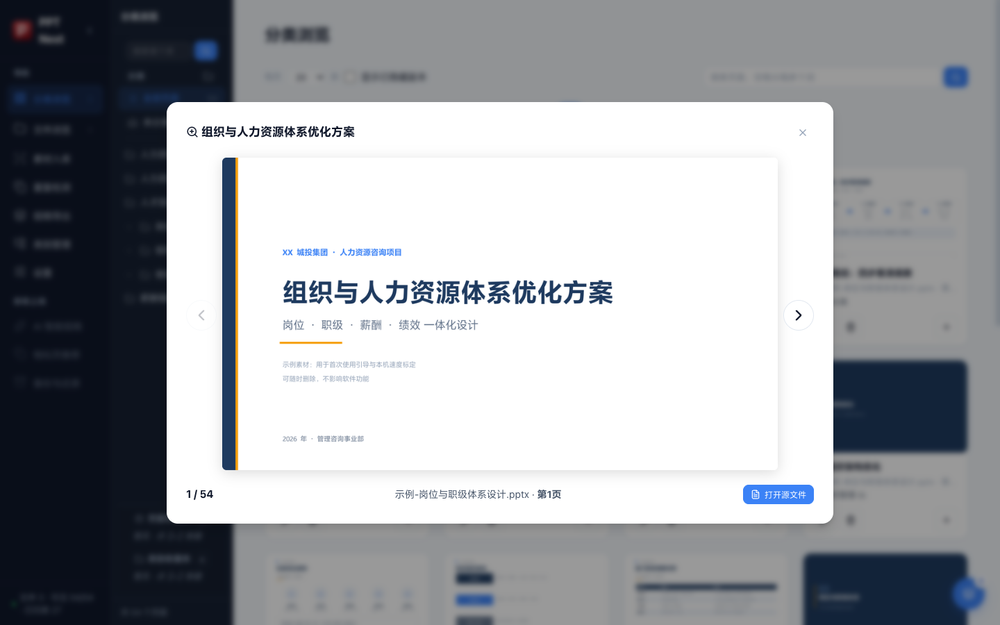
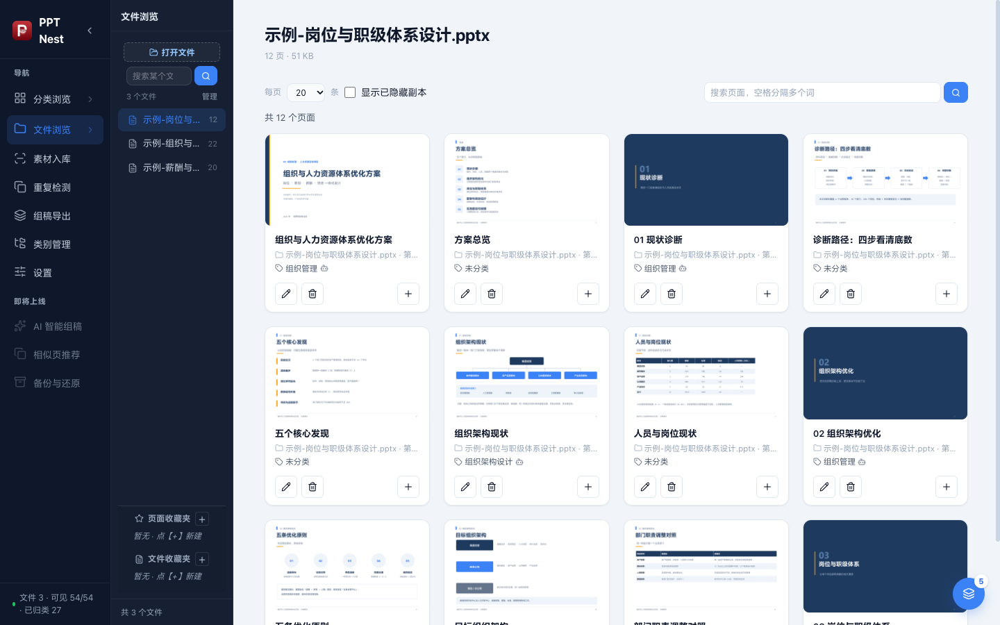
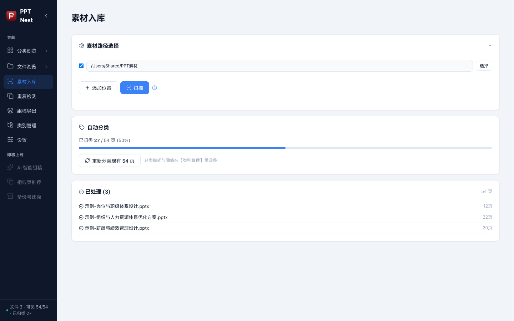
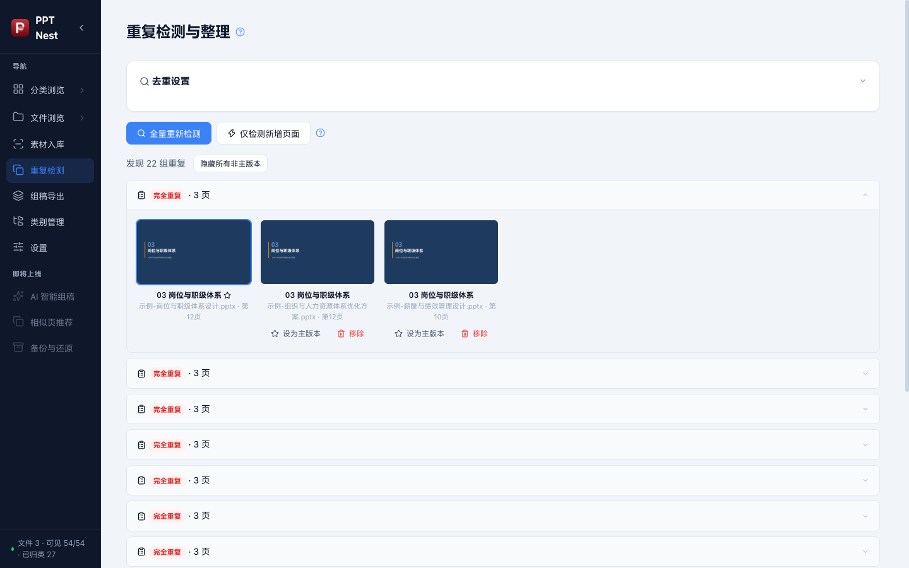
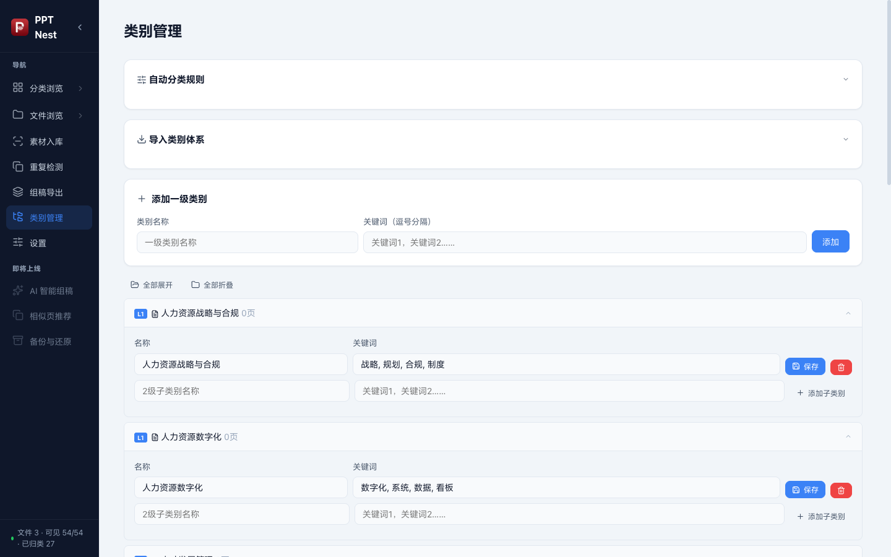

# PPT Nest · 片巢 — 使用说明与功能介绍

> 一个本地化的 PPT 素材库管理工具：把你积攒的几百个 PPT 文件拆解成一张张可检索、可归类、可收藏的幻灯片页面。
>
> 适用版本：v2.6.x ｜ 适用平台：Windows 10+ / macOS 12+（Apple 芯片）

---

## 一、软件简介

### 1.1 这是给谁用的？

做咨询、做培训、做方案的人，电脑里往往躺着成百上千个 PPT。想找"一页讲薪酬体系的图"时，却只能一个文件一个文件地翻。

**PPT Nest 的核心思路是：把"文件"打散成"页面"。**

- 扫描指定文件夹，自动解析每个 PPT 的每一页
- 为每页生成缩略图、提取标题和正文
- 用关键词（可选大模型兜底）自动归类到你的分类体系
- 跨文件找出完全重复 / 高度相似的页面，一键隐藏副本
- 像图库一样浏览、搜索、收藏、放大预览，还能一键跳回源文件

### 1.2 核心功能一览

| 功能 | 说明 |
|---|---|
| 📂 批量扫描 | 递归扫描 PPT/PPTX，增量处理（按修改时间 + 大小判断变更），损坏文件部分解析并明确提示 |
| 🖼️ 缩略图 | Windows 走 PowerPoint COM、macOS 走 LibreOffice 无头渲染导出真实缩略图；两者都没有时自动生成占位图 |
| 🏷️ 智能归类 | 关键词加权打分（标题 ×2、正文 ×1、路径 ×0.6）+ N 级子类级联；支持任意 OpenAI 兼容大模型兜底 |
| 🔁 重复检测 | 内容哈希精确去重 + n-gram 预筛 + 模糊相似度检测（阈值可调），独立子进程运行不卡界面 |
| ⭐ 收藏夹 | 跨文件挑选页面组成自己的专题合集 |
| 🔍 页面搜索 | 在「分类浏览」「文件浏览」右上角按标题 + 正文搜当前范围内的页，多关键词空格分隔、词间 AND |
| 🗂️ 多级分类 | 最多 5 级分类树，支持 JSON 一键导入/导出 |
| 🔍 放大预览 | 键盘 ← → 翻页浏览，可直接打开对应源 PPT |
| 📤 组稿导出 | 手动挑页 + 拖拽排序，把多份 PPT 里的页面拼成一份新文件；同源页 100% 保真 |

### 1.3 数据完全本地化

所有数据（数据库、缩略图、分类配置）都保存在你自己的电脑上，默认位于 `%APPDATA%\ppt-nest\data`（Windows）或 `~/Library/Application Support/ppt-nest/data`（macOS），不上传任何内容。唯一例外是你主动启用了"大模型归类"功能时，待分类页面的标题与正文会发送给你自己配置的 LLM 服务商。

---

## 二、安装与启动

### 2.1 安装

1. 到 Releases 页面下载 `PPT Nest Setup x.x.x.exe`
2. 双击安装，可自定义安装目录
3. 安装完成后桌面会出现 **PPT Nest** 快捷方式，双击启动

### 2.2 关于 Microsoft PowerPoint（可选但推荐）

| 环境 | 效果 |
|---|---|
| 已安装 Microsoft PowerPoint | ✅ 真实渲染缩略图（所见即所得）；✅ 支持 .ppt 旧格式 |
| 未安装 Office | ⚠️ 仍可正常使用，缩略图为占位图，仅支持 .pptx |

> WPS 目前不提供 COM 渲染通道，建议安装 Office 以获得最佳缩略图效果。

### 2.3 首次启动引导

第一次打开软件会进入新手引导，只需指定**存放 PPT 文件的文件夹**（扫描目录），软件即可开始工作。之后随时可以在「扫描处理」页修改。

---

## 三、界面总览

启动后的主界面分为三个区域：

```
┌──────────────┬─────────────────┬──────────────────────────┐
│  主导航栏     │   二级面板        │        主内容区            │
│ （分类浏览/   │ （分类树 或       │  （幻灯片卡片网格 /        │
│  文件浏览/    │   文件列表，      │    各功能页面）            │
│  扫描/去重/   │   仅浏览类页面    │                          │
│  组稿/类别/   │   显示）          │                          │
│  设置）       │                  │                          │
└──────────────┴─────────────────┴──────────────────────────┘
```

- **左侧主导航**：七大功能页 + "即将上线"预告区。主导航可折叠（点品牌栏右侧箭头），折叠后仅保留图标。
- **二级面板**：在「分类浏览」页显示分类树，在「文件浏览」页显示文件列表；两页底部都有「页面收藏夹 + 本模块收藏夹」的固定区，支持拖拽调整宽度。
- **两个折叠小三角各管各的**：在分类浏览里折叠不影响文件浏览（反过来也一样），切回某个模块时它还是你上次留下的样子；不在该模块时点它的三角，等于直接跳过去并把面板展开。
- **底部状态栏**：实时显示文件数、可见页面数、已归类页面数。

---

## 四、快速上手：五步建立你的素材库

1. **设置扫描位置** → 扫描处理页，点「选择…」挑一个或多个放着 PPT 的文件夹（会递归扫子文件夹，文件留在原地，不会被复制）
2. **点「检查新增」→ 看完清单点「导入选中的 N 个」** → 不跳页，直接在当前页盖一层进度浮动窗口，下层点不动；解析每页、生成缩略图并入库。点「取消导入」是秒停：正在导的那份文件会整份撤回（不留半截页），已经导完的文件保留
3. **等待自动分类** → 关键词命中的页面自动归类；拿不准的留给"未分类"或交给 LLM
4. **跑一次重复检测** → 找出跨文件重复页，一键隐藏所有副本
5. **开始使用** → 浏览、搜索、收藏，找到想要的页面一键打开源文件

---

## 五、功能详解

### 5.1 分类浏览



这是软件的首页，也是日常使用频率最高的页面。

**左侧分类树**

- **全部页面**：查看库中所有可见页面
- **未分类**：尚未匹配到任何分类的页面，方便人工补归类
- **分类树**：最多支持 5 级层级。点击分类名称查看该分类下的页面；点击分类前的箭头可展开/收起子分类（子分类数量会显示在右侧）
- **搜索框只搜类别**：输入关键词过滤分类树（父级命中时子级一并显示；空格分隔多个词要求全部命中）；回车打开第一个结果，↑↓ 换下一个、Esc 清空、框内 ✕ 一键清空。选完一个类别后关键词和结果都留着，可以接着点下一个。要搜页面内容用右侧网格顶部的搜索框（详见 5.4）
- **⭐ 收藏夹**：你创建的专题合集会显示在这里（详见 5.8）

**右侧卡片网格**

每张幻灯片卡片包含：

- **缩略图**：真实渲染的页面预览（鼠标悬停出现快捷按钮：🔍 放大、⭐ 收藏、📄 打开源文件）
- **标题与正文摘要**：解析出的页面文字内容
- **来源信息**：`📁 文件名 · 第 N 页`，点击可直接定位
- **分类标签**：`🏷️` 显示当前所属分类，带 🧠 图标表示由 LLM 归类
- **操作按钮**：✏️ 编辑（改标题/手动改分类）、🗑️ 删除该页，这两个在左边；**➕ 加入稿件**固定在右边（加入「上次用的那份组稿」，提示会告诉你加到哪份、现在几页）

**右下角「当前组稿」浮栏**

只要当前组稿里已经有页，「分类浏览」页的右下角就会常驻一个主题蓝圆按钮，右上角的小圆标是页数：

- 点它从按钮**上方往上展开**浮层，列出这份组稿里现在的所有页（序号、缩略图、标题、来源页），顺序就是导出时的顺序。**列表最多露出 10 行**，再多就在框里滚动
- 点某一行的**缩略图**可以直接看大图（←/→ 翻页，Esc 关闭）
- 每行右侧的 **×** 直接把这页从组稿里拿掉（不删素材库里的页，也不影响源 PPT），提示会告诉你删了哪页、现在几页
- 浮层标题栏右侧的【清空】**一键清空**整份组稿（同样只动组稿，素材库和源文件都不碰）
- 再点圆按钮收起。组稿被清空、或切到别的页（文件浏览 / 素材入库等），浮栏自动消失
- **提示条在右上角**：从上往下叠，最新的在最上面；每次动作各出一条（连点几个＋就是几条，页数递增），最多同时 5 条，再多的把最早的挤掉；每条出来就开始淡淡地褪，6 秒彻底消失

**顶部工具栏**

- **页面搜索（右侧）**：在当前范围里搜页面内容（标题/正文）。和左侧面板的搜索是两级：左侧那个搜的是「类别 / 文件」这类目录，这一个搜的是具体的页；两个可以同时生效，互不覆盖
  - **每个关键词是一张卡片**：输入后按空格或回车，这个词就变成一张卡片（一次粘贴「薪酬 绩效 岗位」会拆成多张）；卡片上的 ✕ 单独删掉那一个词，右边单独一个 ✕ 清空全部。多个词之间是「全部命中」（例如「薪酬 绩效」只出同时提到这两词的页，顺序无关、全角空格也认）
  - 敲字时还没成卡的那一段也参与过滤（防抖 0.3 秒），所以边输边看结果；空输入时按 Backspace 删最后一张卡片；Esc 清空全部
  - 切到别的分类 / 文件时卡片保留，筛选范围换成新的范围（卡片就是搜索条件，不该被切换动作清掉）；没有匹配时只显示「没有匹配的页面」
- 每页显示条数切换（20 / 50 / 100）
- ☑️ 显示已隐藏副本（被去重隐藏的页面可临时显示）
- 分页器：页码跳转 + 「共 N 页 / N 个页面」统计

> 💡 **删除页面说明**：删除会从源 PPT 文件中**真实删除该页**并同步刷新缩略图与页码，操作前请确认源文件未被 Office 打开占用。

### 5.2 放大预览



点击卡片缩略图上的 🔍 按钮，进入沉浸式大图预览：

- **高清大图**展示当前页面
- **← / → 方向键**或两侧箭头在当前筛选结果中翻页
- 底部显示 `当前位置 / 总数`、来源文件与页码
- **「打开源文件」**按钮：直接在 PowerPoint 中打开对应 PPT，方便编辑取用
- 按 `Esc` 或点击 ✕ 关闭预览

### 5.3 文件浏览



以"文件"为维度查看素材库：

- 左侧面板列出所有已入库的 PPT 文件（含各文件页面数）
- **搜索框只搜文件**：输入关键词只过滤文件列表（空格分隔多个词要求全部命中）；回车打开第一个结果，↑↓ 换下一个、Esc 清空、框内 ✕ 一键清空。点开某个文件后关键词和结果都留着，可以接着点下一个，不用重新输入
- 点击某个文件，右侧展示该文件的**全部页面**；页头显示文件名、页数和大小
- 右侧顶部那个页面搜索同样可用：它只在**这份文件内部**搜页面内容，和左侧的文件搜索互不覆盖
- **左侧顶部【打开文件】**：选一个或多个 PPT 打开，直接走「入库」流程（和 Finder 右键【打开方式】同一条链路）：先问要不要归类 → 按页显示进度 → 导入完自动选中这份文件，列表里那一行会闪一下
- **右键菜单**：在文件列表里右键某个文件，弹出三个操作——【打开】（等同于点这一行）、【加入收藏夹】（把整份 PPT 收进文件收藏夹）、【删除】（和【管理】里的移除同一套强确认，弹窗照样先算影响面）
- **移除文件**：除了右键，也可以点列表上方的【管理】批量删——进入管理后每行前面出现勾选框，勾一个或多个，点【移除 N】；确认弹窗会先算好影响面（多少页、连带清掉几条归类、被哪几个收藏夹和组稿用着、牵涉几个重复组）
- **移除只删素材库**：库里的记录、缩略图、以及指向这些页的归类/收藏/组稿引用会一起清掉，磁盘上的原 PPT 一律不动。移除后它在下次扫描时会重新变成「新文件」，可以再导入；手动归类和收藏会丢

### 5.4 页面搜索（并入分类浏览 / 文件浏览）

> 早期版本左侧有一个独立的【搜索】页，现在已取消：搜页面内容直接在当前模块里搜，不用先跳页。

- **在哪搜**：卡片网格右上角、和「每页 N 条」同一行的搜索框
- **搜什么**：当前范围内的页——搜的是标题 + 正文。范围由左侧选中的东西决定：选了某个分类就搜这个分类（含子分类）下的页，选了某个文件就搜这份 PPT，选了收藏夹就搜夹内的页
- **怎么搜**：输入关键词后按空格或回车变成一张卡片，可以连着敲好几个词；一个词一张卡、卡上的 ✕ 单独删这个词，框右侧的 ✕ 清空全部；粘贴「薪酬 绩效」会自动拆成两张卡
- **多个词之间是「都要命中」**（AND，顺序无关，全角空格也认）
- 清空关键词后自动回到完整列表，不用手动刷新

移除了独立搜索页后，页面内容的检索能力没有减少，只是不再需要跳页。

### 5.5 扫描处理



扫描页分为四个板块：

**① 扫描设置**

- **扫描位置**：可以配多个目录（工作盘、桌面、外接盘、网盘挂载点各一条），每条都能单独关掉。每个位置都递归包含子文件夹；点「选择…」用系统对话框挑目录，不用手打路径，**改完点「保存扫描位置」**才算生效
  - 应用**不会复制你的 PPT**，只存缩略图、标题正文和分类，记录的是源文件路径；额外占用只有缩略图（约 160 KB/页）
  - 自动跳过：`~$` 临时锁文件、`.icloud` 云盘占位、0 字节文件、`.` 或 `_` 开头的目录、`node_modules`/`.git`/回收站这类目录
  - **同名文件只入库最新版本**（默认开）：同一个文件名出现在多个目录时，只处理修改时间最新的那一份，旧的列为「同名旧版本」跳过；一个客户存了七八个版本时靠这条把库压干净。要全部入库就取消勾选，再点「保存扫描位置」
- **分类模式 / 置信度阈值**：已经移到下面的「自动分类」卡片里，设完点那张卡上的「保存分类设置」

**② 文件扫描（先看清单，再决定导什么）**

- **检查新增**：只读地走一遍所有扫描位置，列出会发生什么——每个文件的大小和状态（新文件 / 改过需重扫 / 移动或改名 / 已入库），以及跳过了几个临时文件、云盘占位、0 字节文件、同名旧版本
- 清单里可以按目录折叠、逐条勾选，默认只勾「新文件 / 改过 / 移动」，已入库的置灰不可选；每个目录名前面有一个勾选框，点一下整个目录（一个客户）一起选；表头文件名列左边那一个是全选——全部勾满时点一下全部取消，只勾了一部分时显示横杠，点一下补齐成全选。确认后点「导入选中的 N 个」才开始解析和渲染缩略图
- **全部处理**：不想逐条挑时一键处理所有待处理项
- **移动认领**：把文件从 A 目录挪到 B 目录（或改名）后，只要文件名和大小不变，应用会认出是同一份，只更新路径——不会重复入库，也不会把旧记录当成「已删除」
- 扫描过程显示实时进度（按**页数**走：已处理 X / Y 页，当前文件还会显示缩略图渲染到第几页），可随时**取消**；损坏的文件会跳过页面级错误、保留可解析部分并明确提示
- **清理失效记录**：源 PPT 已经不在原路径的文件，会先列出清单让你确认，确认后只删素材库记录和缩略图，不动磁盘文件

**③ 自动分类**

- 显示归类进度条（已归类 / 总页数）
- 分类模式、置信度阈值就在这里设，改完点「保存分类设置」；有已入库页面时会问要不要立刻重新分类
  - `仅关键词`：不花一分钱，靠关键词打分归类
  - `关键词 + LLM（推荐）`：关键词拿不准的页面才调用大模型，省钱省时
  - `仅 LLM`：全部交给大模型判断
  - 阈值：关键词得分低于该值的页面，在混合模式下交由大模型二次判断
- **重新分类**：修改了分类关键词或 LLM 配置后，可一键对全库重新归类

**④ 已处理文件清单**

每个已入库文件的状态（页数、成功/部分失败标记）一目了然。

> 💡 **扫描很慢？** 瓶颈在 PowerPoint COM 渲染缩略图，每页约 0.5~2 秒属正常。扫描在后台线程运行，不阻塞其他操作。

### 5.5.1 右键直接打开 PPT（不走扫描位置）

除了「扫描位置」里的目录，也可以直接双击 / 右键打开某一个 PPT 交进来处理：

- **怎么打开**：①「文件浏览」页左侧顶部的【打开文件】按钮（选一个或多个，最省事）；②装好的应用会注册为 PPT 的打开方式，Finder 里右键 PPT →【打开方式】→ 选本应用；③把文件拖到 Dock 上本应用的图标
- **应用已开着时**：不会再开第二个窗口，文件直接送进已经在跑的这个窗口（这一点很重要，两个实例同时写库会打架）
- **会先问一句「新文件要归类吗？」**：
  - 点【自动归类】：按你库里**已有类别**的关键词把页归进去，完成后告诉你归了多少页
  - 点【不归类】：只入库，页全在「未分类」，之后在卡片上点 ✏️ 手动归
  - 库里一个类别都没有时不问，直接入库
  - 点弹窗右上角 ✕ 或点空白处关掉，等同【不归类】，不会卡住
- **已经在库里的同一个文件**：提示「已在库里，跳过」，不会重新解析——重解析会先删掉它所有页，连带清空组稿、收藏夹里引用它的页
- **导入完**：自动切到「文件浏览」并选中这份文件，左侧列表里那一行会闪一下；页进了库就能照常用【＋】加进组稿
- **导入过程**：浮层按页显示「已处理 X / Y 页 · 第 i/n 个文件」，正在转的这份再补「缩略图 3/19 页」
- **一次打开多个文件**、或打开时恰好有扫描在跑：前者逐个导入并在最后汇总，后者会提示「正在扫描或导入中，等这次做完再打开文件」

### 5.6 重复检测



几百个 PPT 里往往躺着大量复制粘贴出来的重复页。重复检测帮你把它们找出来并清理掉。

**检测设置**

- **相似度阈值**（0.50 ~ 1.00，默认 0.85）：阈值越低，判重越宽松。滑块调节后点「保存阈值」

**两种检测方式**

- 🔍 **全量重新检测**：对全库所有页面重新计算
- ⚡ **仅检测新增页面**：只把新入库页面与已有页面比对，速度快，适合日常增量

**检测结果**

- 以"重复组"列表呈现，每组标注 **完全重复**（内容哈希一致）或 **高度相似**（模糊相似度超过阈值）及组内页数
- 展开每个重复组，可以：
  - **设为主版本**：选择组内保留哪一页
  - **移除成员**：把某页从组中移出（不视为重复）
  - **隐藏所有非主版本**：一键隐藏全部副本，浏览时不再干扰；随时可恢复
- 被隐藏的副本不会从磁盘删除，只是从浏览视图中隐去；「显示已隐藏副本」开关或"恢复隐藏"都能找回

**技术说明**：检测采用"内容哈希精确去重 + n-gram 预筛 + rapidfuzz 相似度"三级算法，在独立子进程中运行，跑大批量数据也不会卡住界面，进度实时可见。

### 5.7 类别管理



管理你的分类体系（自动归类的依据）：

- **导入类别体系**：从 JSON 文件一键导入整套分类树（附 AI 生成分类体系的提示词模板，可以先让大模型帮你设计分类）
- **导出**：把当前分类体系导出为 JSON 备份
- **添加一级类别**：填写类别名称 + 关键词（逗号分隔）即可新增
- **分类列表**：全部展开 / 全部折叠；每个类别支持
  - 展开查看/添加**子类别**（最多 5 级）
  - 编辑名称与关键词
  - 删除（页面回到"未分类"）

**归类是怎么打分的？**

系统遍历每个类别的关键词，在幻灯片的标题、正文、文件路径中搜索：

- 标题命中权重 ×2，正文 ×1，路径 ×0.6
- 长关键词（≥4 字）额外 ×1.5 加分
- 置信度 ≥ 阈值 → 直接归入得分最高的类别
- 置信度 < 阈值 → 仅关键词模式不归类；混合模式交由大模型二次判断
- 命中父类后还会继续向子类**级联下沉**，落到最细的层级

### 5.8 收藏夹（页面 / 类别 / 文件）

收藏夹分三种，互不混合：

| 类型 | 装什么 | 在哪 | 怎么加 |
| --- | --- | --- | --- |
| ⭐ 页面收藏夹 | 单页 | 分类浏览、文件浏览**两边都有**（同一份数据） | 卡片上点 ⭐ |
| 📁 类别收藏夹 | 分类（整个分类，含子分类） | 分类浏览 | 分类树上右键分类 →【加入类别收藏夹】 |
| 📄 文件收藏夹 | 整份 PPT | 文件浏览 | 文件列表右键文件 →【加入收藏夹】 |

- **位置固定**：两个模块的收藏夹区都钉在左侧面板**底部**，顺序永远是「页面收藏夹 → 本模块自己的收藏夹」。上面那半截（分类树 / 文件列表）单独滚动，收藏夹不跟着滚走
- 每块右上角【+】新建；三种夹子都支持重命名、删除（删除只解散夹子，页面/分类/文件本身都不动）
- 点开收藏夹，右侧铺出里面的页：页面夹只出收藏的那几页；类别夹出这些分类（含子分类）下的所有页，页头显示「N 页 · M 个分类」；文件夹出夹内所有文件的全部页，页头显示「N 页 · M 个文件」
- 点开时**留在当前模块**：在文件浏览里点页面收藏夹，左侧仍是文件列表，只是右侧换成那几页
- 想移出成员：页面夹在卡片上点 ⭐ 取消；类别夹右键分类、【加入类别收藏夹】把勾去掉；文件夹右键文件、【加入收藏夹】把勾去掉
- 缩略图上的 ⭐ 只往**页面收藏夹**里收（类别/文件收藏夹不装单页）
- **在卡片上改收藏夹名字**：卡片下方那排按钮里的 ✏️【编辑标题与分类】→ 弹窗中「页面收藏夹」一节，每个夹一行：左边勾选框=这一页是否在里面，右边输入框直接改名字。改完点【保存】，侧栏、卡片上的收藏标签一起更新；名字留空等于不改

### 5.9 组稿导出（把挑好的页拼成一份新 PPT）

「组稿导出」页是一个双栏工作台：左边是素材库，右边是你的稿件。

1. **挑页**：在左边用搜索 / 分类 / 来源文件筛选，鼠标移到缩略图上会浮出两个按钮（位置和「分类浏览」里的完全一样）：🔍 放大查看、**+** 加入稿件。只有点 **+** 才会加入（点卡片其他地方不会加，避免误触），同一页可以加多次；大图里可用 ←/→ 翻页，翻页顺序跟左边当前的筛选列表一致
2. **顺手加页**：「分类浏览」的卡片**底部那排按钮最右侧**就是 **+ 加入稿件**（左边是 ✏️ 编辑和 🗑 删除，三个一样高、同一行）；缩略图悬停只剩放大、收藏、打开源文件。加入的是**上次用的那份组稿**（刚打开组稿页那一份），成功后右下角会提示加到哪份、现在几页，不用先切到组稿页
3. **排顺序**：按住稿件里的行上下拖动即可改顺序，序号自动重排；点行上的 **×** 移除
4. **导出前体检**：点「导出 PPTX」会先体检一遍，有问题就弹窗告诉你——源文件找不到了、源文件入库后被改过、页面比例混排（4:3 和 16:9 拼在一起）、哪几页会降级成整页图、同一页重复出现。可以「回去改」也可以「仍然导出」；没有问题时这步直接跳过
5. **成套改字**：体检之后可以填最多三组「原文 → 替换成」，一次性把整套里的客户名、项目名换掉。**只作用于这次导出的文件**，素材库和源 PPT 都不动，备注里的字也会改；图表与 SmartArt 里的文字改不了，导出完成会告诉你有几处没改到。不想改就点「不改，直接导出」
6. **导出**：选保存位置（每次都弹框），等进度条走完即可；导出后会自动在文件管理器里定位到产物

稿件是边改边存的，没有"保存"按钮；可以同时建多份组稿（顶部下拉切换），互不影响。导出**不会改动源 PPT 文件**。

### 5.9.1 骨架（把一份定稿的页序存成样板）

稿件栏顶部那个「层叠」图标是**骨架**面板：

- **把当前稿件存为骨架**：这份稿件的页序就被记住了（存成骨架后不再出现在普通组稿下拉里）。
- **用它新建**：按骨架的页序，逐页拿每页的标题去素材库里找最相似的一页，拼成一份**新组稿**。结果会列出每页是「原页 / 相似页 / 勉强匹配 / 没配到」，标后两类的优先人工复核。

骨架只是"第几页该放什么"，不动库里任何素材；生成的新组稿是普通组稿，照常拖拽和导出。

导出的保真度取决于页面来自几个源文件：

| 情况 | 处理方式 | 还原度 |
|---|---|---|
| 所有页来自同一个 PPT | 复制源文件、删掉没选的页、按你的顺序重排 | 100%，母版、主题、背景、SmartArt 全都在 |
| 页面来自多个 PPT | 以页数最多的那份为底，其他文件的页搬进来 | 文本、图片、表格、形状、配色正常；页码位置统一 |
| 某页含图表 / SmartArt / 嵌入对象 | 无法可靠搬运，改用该页的高清整页图，来源写进备注 | 画面一致，但这页不能再编辑文字 |

### 5.10 设置


**① 存储路径**

- 数据目录默认为 `%APPDATA%\ppt-nest\data`（Windows）或 `~/Library/Application Support/ppt-nest/data`（macOS），包含 SQLite 数据库与缩略图
- 可改到任意目录（如大容量硬盘），卸载软件数据不丢失

**② 大模型 API 配置**

- 提供商下拉：智谱 / DeepSeek / 通义 / Kimi / OpenAI / 其他（任意 OpenAI 兼容接口）
- 填写 **API Key**、**Base URL**、**模型名称** 后保存
- 配合扫描设置中的"关键词 + LLM"混合模式使用，成本可控

**③ 联系我**

- 邮箱：egohug@126.com

**④ 帮助与反馈**

- 🌟 点亮 Star ｜ 🔍 检查更新 ｜ 📝 反馈 Bug ｜ ✉️ 邮件反馈
- 版本号在此可见，反馈问题时附上版本号和日志（`pptnest.log`）能更快定位

**⑤ 支持作者**

- 打赏二维码（微信赞赏 `egohughu`）与公众号「岱森驻场」二维码，扫码即可
- 公众号「岱森驻场」：拥抱奇点，与硅基灵魂共舞

**⑥ 危险操作**

- 修复缩略图、清空全部数据等高风险操作集中在此，执行前有二次确认

---

## 六、即将上线

以下功能已在规划中，敬请期待：

| 功能 | 说明 |
|---|---|
| ✨ AI 智能组稿 | 根据需求描述，自动从素材库挑选页面并拼成 PPT 初稿 |
| 🔍 相似页推荐 | 基于现有去重算法，为当前页面推荐风格或内容相似的其他页面 |
| 💾 备份与还原 | 一键打包数据目录，支持换机迁移 |

---

## 七、常见问题（FAQ)

**Q: 扫描很慢怎么办？**
A: 瓶颈在 PowerPoint COM 渲染缩略图，每页约 0.5~2 秒属正常。扫描在后台运行，可随时取消；二次扫描为增量处理，只处理变更文件。

**Q: 大模型归类怎么配置？会不会很贵？**
A: 设置 → 大模型 API 配置，选择提供商并填写 API Key。推荐使用"关键词 + LLM"混合模式：只有关键词拿不准的页面才会调用大模型，省钱省时。

**Q: 删除页面会发生什么？**
A: 会从源 PPT 文件中真实删除该页并同步刷新缩略图与页码。操作前请确认源文件未被 Office 打开占用。

**Q: 隐藏重复副本会删文件吗？**
A: 不会。"隐藏"只是从浏览视图中隐去非主版本，磁盘上的源文件不受影响，随时可恢复显示。

**Q: 数据存在哪里？换电脑怎么办？**
A: 默认在 `%APPDATA%\ppt-nest\data`（Windows）或 `~/Library/Application Support/ppt-nest/data`（macOS），可在设置中修改，包含 SQLite 数据库与缩略图，卸载不丢失。换机时整体拷贝该目录即可（后续版本将提供一键备份还原）。

**Q: 没有安装 Office 能用吗？**
A: 可以正常使用，但缩略图为占位图，且仅支持 .pptx 格式。安装 Microsoft PowerPoint 后自动获得真实渲染缩略图与 .ppt 支持。

---

## 八、技术架构（供参考）

```
┌─────────────────────────── Electron 桌面壳 ───────────────────────────┐
│  main.js  窗口管理 / 后端进程生命周期 / 端口自适应                        │
│  frontend/  原生 JS + CSS 单页应用（无框架，轻量）                       │
└──────────────────────────────┬────────────────────────────────────────┘
                               │ REST API (127.0.0.1)
┌──────────────────────────────┴────────────────────────────────────────┐
│  Python 后端 (FastAPI + Uvicorn，PyInstaller 打包为 server.exe)         │
│  ├── scanner.py       扫描调度（解析→缩略图→归类→入库）                  │
│  ├── ppt_parser.py    python-pptx + PowerPoint COM 双通道解析           │
│  ├── classifier.py    关键词分类器（加权/互斥规则/级联下沉）              │
│  ├── llm_classifier.py 大模型归类（OpenAI 兼容协议）                     │
│  ├── dedup.py         去重算法（哈希 + Jaccard 预筛 + rapidfuzz）       │
│  ├── dedup_worker.py  去重独立子进程                                    │
│  └── database.py      SQLite (WAL) 数据层                              │
└────────────────────────────────────────────────────────────────────────┘
```

**技术栈**：Electron · FastAPI · SQLite(WAL) · python-pptx · pywin32(COM) · Pillow · rapidfuzz · PyInstaller · electron-builder

---

## 九、反馈与联系

- 🐛 **提 Issue**（推荐）：GitHub Issues 选择「Bug 反馈」或「功能建议」模板
- 💻 **软件内反馈**：设置 → 帮助与反馈 → 「反馈 Bug」或「邮件反馈」
- 📧 **邮箱**：[egohug@126.com](mailto:egohug@126.com)
- 💬 **微信**：`egohughu`（欢迎交流反馈）
- 📢 **公众号**：岱森驻场

反馈时附上版本号（设置 → 帮助与反馈 可见）和 `pptnest.log` 日志片段，能帮助我们更快定位问题。

---

## 十、许可证

本项目基于 [MIT License](../LICENSE) 开源，Copyright (c) 2026 egohug。

你可以自由使用、修改、分发本软件，包括用于商业用途，只需在副本中保留原始版权与许可声明。软件按「现状」提供，不附带任何形式的担保。

---

<p align="center"><strong>如果 PPT Nest 对你有帮助，请点个 ⭐ 星标，让更多人找到它！</strong></p>
